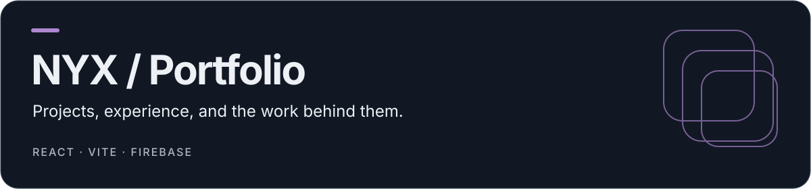
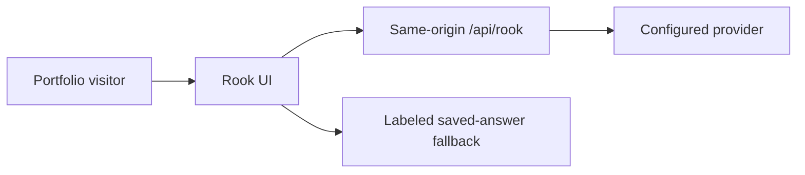

<p align="center">
  
</p>

# NYX / Portfolio

A responsive personal portfolio built with React 19, Vite and styled-components. It presents curated projects, case studies, experience and résumé downloads, with an optional Rook portfolio assistant.

[Live portfolio](https://iamnyx.web.app) · [Setup](#setup) · [Configuration](#configuration) · [Deploy](#deployment) · [Checks](#checks)

## What is here

| Surface   | Purpose                                                                              |
| --------- | ------------------------------------------------------------------------------------ |
| Portfolio | Project cards, case studies, experience and contact actions                          |
| Content   | Structured facts in `src/data/portfolio.js`                                          |
| Design    | Responsive sections, motion and a retro/cyberpunk visual system                      |
| Résumé    | Generated one-page PDF variants and preview                                          |
| Rook      | Optional same-origin portfolio Q&A, with an explicitly labeled saved-answer fallback |

## Setup

Use Node **22**, matching the deployment workflow, and npm with `package-lock.json`:

```sh
git clone https://github.com/coding-nyx/portfolio.git
cd portfolio
npm ci
npm run dev
```

```sh
npm run lint
npm test
npm run test:rook
npm run build
npm run audit:bundle
npm run preview
```

The app's configured features depend on their environment; a successful static build does not prove email delivery or a live AI response.

## Configuration

See `.env.example` and the deployment workflow for variable names. `VITE_FIREBASE_*` and `VITE_EMAILJS_*` are browser-visible configuration; missing configuration should not be presented as successful email delivery or analytics initialization.

The server-only Rook provider credential is `DEEPSEEK_API_KEY`. Never prefix it with `VITE_`, commit it, include it in a URL or expose it in a client bundle. Configure credentials privately; this documentation update does not call or configure a provider.

## Rook architecture



The shared handler is `server/rook.mjs`. Local development/preview wiring and the Firebase Function package use that handler. Provider requests process the visitor question with public portfolio context; Rook does not send contact emails. The UI distinguishes a provider response from its saved-answer fallback.

## Deployment

The [GitHub workflow](.github/workflows/firebase-hosting-merge.yml) handles `main` pushes, runs the portfolio/Rook regression gates, builds the site and deploys Firebase Hosting with the configured backend route. Read [DEPLOYMENT.md](DEPLOYMENT.md) before changing the project, service account or backend rollout.

Use a protected service-account/Secret Manager configuration and choose the target Firebase project explicitly. Hosting deployment, function deployment and provider-secret provisioning are separate operations. Publishing documentation does not imply a provider credential was rotated or a new backend was deployed.

## Customize

- **Content:** `src/data/portfolio.js`.
- **Sections:** `src/components/` and the app shell in `src/App.jsx`.
- **Theme:** `src/styles/GlobalStyle.js` and component styles.
- **Contact:** `src/services/emailService.js` and the configured client environment.
- **Rook:** `server/rook.mjs`, `functions/` and `scripts/build-functions.mjs`.

## Rebuild the résumé

```sh
python3 scripts/build-resume.py --output-dir public
```

The generator uses portfolio facts and requires Node plus Python `reportlab`, `pypdf` and `pypdfium2`. Review the generated preview and both PDFs before publishing; keep claims and links tied to confirmed facts.

## Checks

`npm test` covers portfolio regressions; `npm run test:rook` covers the Rook handler/UI contract; `npm run audit:bundle` checks the built output. Browser verification scripts in `verification/` require a separately installed Playwright environment and a deliberately started local server.

No top-level license file is present in the current tree. The README does not introduce a new license grant.
