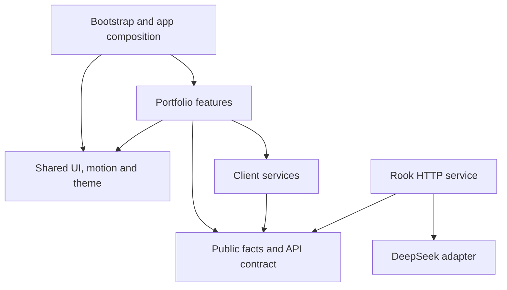

# Portfolio architecture

The client is a feature-based React SPA with layered dependencies. The backend is one small HTTP service for Rook, shared by local development and Firebase Functions. This structure keeps the portfolio straightforward to extend without adding a routing framework, a global business-state store, or service abstractions that the current app does not need.

## Source layout

```text
src/
  main.jsx                  React bootstrap
  app/                      Providers, page composition, navigation, footer, failure UI
    navigation/             Chapter selection, scrolling, focus and navigation view
  features/
    profile/                Original hero, bio and résumé
    experience/             Career view and timeline calculation
    projects/               Desktop grid, mobile carousel, shared details owner
      island/               Optional WebGL lifecycle and procedural world builder
    skills/                 Skill selection and evidence mapping
    achievements/           Professional milestones and certifications
    personal/               Race milestones, interests and finisher celebration
    contact/                Contact view, form hook and pure form model
    rook/                   Launcher, lazy dialog/messages, conversation hook and guidance model
  shared/
    ui/                     Reusable actions, links, entrances, dialog styling and error boundary
    motion/                 Preference provider, hooks and lazily loaded animation features
    theme/                  Theme provider, tokens/global styling and optional overlay
  services/                 Rook HTTP/fallback, contact delivery and optional analytics
  data/                     Public portfolio facts, chapter definitions and Rook wire limits
  utils/                    Pure public-text formatting
  vendor/                   Existing vendored Three.js engine
server/
  rook.mjs                  Stable HTTP entry point and request orchestration
  rook/context.mjs          Public facts and server-owned system prompt
  rook/validation.mjs       Bounded JSON parsing and message validation
  rook/provider.mjs         DeepSeek request/response translation
functions/index.mjs         Firebase runtime adapter
```

The app eagerly composes all professional/personal sections. Each feature owns its view, local state and styles. Contact and Rook keep substantial stateful behavior in hooks; skills and career timelines use pure model modules. Projects owns one details dialog shared by its grid, carousel and island.

Experience records with unconfirmed dates, such as college startup work, use the same role selector and detail panel but omit timeline bars rather than imply a date range.

The original hero is retained. Component names now describe responsibilities instead of design-study variants such as `BioB` and `ProjectsG3v2`. Some CSS class names remain from the approved design to preserve its appearance.

## Dependency direction



| Layer          | Allowed local dependencies                         |
| -------------- | -------------------------------------------------- |
| App            | App, features, shared, services, data, utilities   |
| Feature        | Its own feature, shared, services, data, utilities |
| Shared         | Shared and utilities                               |
| Client service | Services, data and utilities                       |
| Data           | Data and utilities                                 |
| Utility        | Utilities                                          |
| Server         | Server, public data and utilities                  |

`config/eslint/architecture.js` checks real import/export/dynamic-import nodes. It rejects unresolved relative imports, missing file extensions, reversed layer dependencies and imports between sibling features. The existing regression suite also checks production module reachability and cycles. These controls are deliberately small and local to this repository.

Public data modules are safe to import in both runtimes. The server prompt and provider credential belong exclusively to the server. No client module imports the server or provider integration.

## State and side effects

- `ThemeProvider` owns the saved theme preference, including an unavailable-storage fallback. `MotionProvider` follows the system reduced-motion preference automatically; there is no separate site toggle or saved motion override.
- Feature state remains local: project selection, contact drafts and Rook history do not live in a global store.
- `useChapterNavigation` owns scroll/hash/selection subscriptions. `navigateToChapter` is the app-owned navigation command used by links and Rook action callbacks.
- `rookClient` performs HTTP/fallback work; it does not emit navigation, scroll or query the DOM. `rookKnowledge` shares project recognition and text normalization between the fallback and feature guidance model.
- Rook's pure conversation model owns explicit navigation-command matching, related portfolio links and unused contextual suggestions. Its hook invokes app callbacks for requested navigation, independently of provider availability. Evidence/topic/source metadata stays in browser memory and is excluded from the HTTP history. The app closes Rook and focuses the requested chapter; résumé requests open the existing theme-appropriate PDF.
- `useRookDialog` owns the main/loading/error dialog's focus cycle, Escape handling, launcher focus restoration and background scroll lock. It follows visual-viewport changes, including reduced available height, and releases its styles and listeners when closed. The conversation log exposes its busy state and a short waiting status.
- `createIsland` owns loading, visibility, resize subscriptions and disposal. `buildIslandWorld` owns the existing procedural geometry, walking and animation behavior.
- The root error boundary provides useful résumé/contact recovery; Rook has a separate boundary so a failed optional chunk does not replace the portfolio.

## Loading policy

| Code                                                        | Loading trigger                                                                       |
| ----------------------------------------------------------- | ------------------------------------------------------------------------------------- |
| Portfolio sections, navigation, preferences                 | Immediate; no boot-animation gate                                                     |
| Motion `domAnimation` features                              | Asynchronous at app startup; included in the UI startup budget                        |
| Rook dialog, Markdown parser, HTTP client and saved answers | First Rook opening; retained after closing to preserve conversation state             |
| Island lifecycle/world                                      | Island selection                                                                      |
| Three.js                                                    | Selected island becomes visible                                                       |
| EmailJS SDK                                                 | Valid, configured contact submission                                                  |
| Firebase Analytics SDK                                      | Configured non-local visit, during idle time; optional failure cannot break rendering |

The build emits a Vite manifest. `npm run audit:bundle` follows the static dependency graph and includes the immediately requested motion features in its UI startup budget: **450 kB minified / 150 kB gzip**. It also asserts that Rook and the island remain dynamic entries. Idle analytics and user-triggered features are outside that critical UI budget; they still have download costs when requested.

The existing Three.js engine remains approximately 664 kB minified / 171 kB gzip and still triggers Vite's unchanged 500 kB per-chunk warning. It is an optional deferred cost. This refactor does not hide the warning by raising the threshold or split one engine into arbitrary files.

## First-party visitor collection

`App → scheduleVisitAnalytics → scheduleFootfallVisit` starts a bounded first-party event sender. `app/usePortfolioAnalytics.js` observes chapter visibility and allowlisted link activations; project details, contact delivery and Rook callbacks emit their own events. No sibling-feature imports or navigation behavior are introduced by tracking. Project identifiers are explicit public data. `data/footfallContract.js` defines the versioned vocabulary, mirrored by the separate Footfall contract.

The queue batches up to ten events, requires explicit event-ID acknowledgements, retries transient errors with fixed limits and attempts a hidden-document flush. IDs and sessions have storage-unavailable fallbacks; idle startup, cleanup, DNT/GPC and the footer opt-out are respected. Scroll/hash navigation is not a new document visit. `services/analyticsPreference.js` owns the saved opt-out for Footfall and optional Google Analytics.

The separate Firebase Spark project `nyx-footfall-analytics` owns Firestore event storage and owner Authentication. `services/footfallFirestore.js` adapts queue batches to create-only REST commits, with immutable server receipt timestamps and per-document ordering. The portfolio stores no IP/hash or IP-derived geography and imports no dashboard UI, Auth credential or database contents. Local development targets only the demo Firestore emulator on port 8085. Production collection is explicitly enabled by `VITE_FOOTFALL_ENABLED=true` or `build:firebase`; no collector API/Hosting rewrite is used. Rook and optional Google Analytics keep their independent existing project. See API.md and ANALYTICS_PLAN.md for quota, delivery and retention limits.

## Styling

Shared section/dialog primitives load before feature styles. Feature-specific rules live beside the feature; app layout/navigation and shared motion effects have their own styles. The existing global styled-components theme is retained. A complete token migration and CSS-class rename are separate work, not claimed as completed here.

## Validation and delivery

`npm run check` runs lint, formatting checks, portfolio regressions, Rook client/server tests, a production build, public-content audit and startup bundle budgets. `npm run build:functions` verifies the Firebase backend package can be generated. CI uses these gates before its existing Firebase delivery step.

Local scratch verification notes and the standalone motion study remain ignored and disconnected from production. The obsolete parallel portfolio components, terminal/sandbox UI, unused integrations, dead boot gate and duplicate package-manager lockfile were removed.

See [API.md](API.md) for request/response details and [CODING_STANDARDS.md](CODING_STANDARDS.md) for enforced principles and explicit remaining gaps. Automated checks do not replace interactive browser verification, real email delivery tests, provider tests or measured Web Vitals.

## Refactor validation snapshot (2026-10-16)

- Node 22.23.3: lint, formatting, **46 tests**, production build, public-content audit, UI startup budgets and Firebase backend packaging passed.
- UI startup JavaScript, including immediately requested motion features: **391.7 kB minified / 128.4 kB gzip**, compared with the previous **629.6 kB / 203.4 kB** entry bundle.
- An in-memory build with placeholder Firebase/EmailJS configuration also passed the budget at approximately **393.0 kB / 128.5 kB gzip**. Firebase modules remained deferred; no provider, analytics or email requests were executed by that build analysis.
- All retained public data exports matched the committed facts, and the original hero JSX matched structurally after ignoring formatting whitespace.
- Old tracked browser screenshots/scripts were untracked while local copies were preserved. The unused phone screenshot and legacy UI/integrations were removed.
- Interactive browser verification was blocked by the browser tool. No claim of visual, swipe, WebGL or focus verification is made for this refactor.

This is a snapshot of the refactor checks; rerun the gates after later changes.

## Rook interaction check (2026-10-16)

The in-app browser was available for this later, targeted QA pass. These checks do not imply full-site or cross-browser coverage.

| Scenario                  | Observed result                                                                                                                                                                                               |
| ------------------------- | ------------------------------------------------------------------------------------------------------------------------------------------------------------------------------------------------------------- |
| Desktop and phone layouts | Checked at 1280×720, 1440×900, 390×844 and 320×568; no horizontal overflow and the question input remained reachable.                                                                                         |
| Reduced height            | At 844×390 and 320×320, compact layout kept the close/input controls within the viewport. Visual-viewport listeners handle available-height changes; a physical phone keyboard was not tested.                |
| Keyboard                  | Initial input focus, a complete seven-control Tab cycle, reverse wrapping, Escape dismissal and launcher focus restoration worked. Tabbing to older links scrolled them into view.                            |
| Live answers              | Public experience and Ara questions returned live answers with related portfolio links and contextual suggestions. No new console warnings/errors appeared after a clean page load.                           |
| Fallback                  | An ignored local fixture returned HTTP 503; stopping that server also exercised a connection failure. Both produced explicitly labeled saved answers and retained related links.                              |
| Cancellation              | Closing during a delayed request aborted it, showed a cancellation notice on reopening, and allowed another question to complete.                                                                             |
| Suggestions and state     | Used project prompts disappeared; after all three were used, the suggestions row disappeared. Closing/reopening retained the conversation and showed the latest reply.                                        |
| Navigation and résumé     | Evidence links and explicit commands closed Rook and focused the requested chapter; navigation also worked with the fixture server stopped. The résumé command opened `/resume-modern.pdf` in a separate tab. |

This pass fixed background scrolling under Rook, increased question-input text to 16 px, added a waiting announcement, and consolidated dialog lifecycle behavior in the feature hook. The isolated fixture, screenshots and scratch verification files stay under ignored `verification/`; they are not production code or tracked tests. Physical iOS/Android keyboard behavior, screen-reader speech, broad accessibility auditing, WebGL and device CPU/memory profiling remain outside this check.

## Portfolio event collection validation (2026-11-09)

- `npm run check` passed: lint/formatting, 23 portfolio regressions, 29 Rook tests, 9 sender/visibility tests, production build and startup budgets. `npm run build:functions` passed. UI startup JavaScript including motion is approximately 403.8 kB / 132.6 kB gzip; the existing deferred Three.js chunk warning remains.
- Separate Footfall checks passed: 13 model/collector tests, TypeScript/build and changed-file formatting. Sender and collector event vocabularies matched.
- Browser actions reached the actual local event ledger and Footfall reports: grid/carousel project opens, résumé intent, Rook opens, outbound source clicks and chapter visibility. The ordered portfolio funnel reconciled with the exercised visit/project/résumé sequence.
- Opting out and opening another project left the received event count unchanged. Owner sign-out locked the report, and sign-in restored it. Footfall reflow was checked at 320 CSS pixels without whole-page horizontal overflow. The portfolio disclosure was inspected at that width and its copyright/text wrapping repaired.
- Unauthenticated aggregate/visitor report requests returned 401; Vite denied private password/database paths with 403. The owner password was absent from the built dashboard JavaScript.
- Contact result handling was validated through event-schema/aggregate tests; no real contact message was sent. Browser offline retries, the island's 3D interaction path, custom date-picker interaction, physical device behavior, screen-reader speech, 200% zoom, production forwarding and real public visitor geolocation were not verified in this pass. Queue failures/cleanup and date validation have automated coverage. Collection remains best effort and local; no publication was performed.

## Firebase Spark Footfall integration (2026-11-10)

The active Spark architecture supersedes the earlier collector/IP/GeoIP validation above. Footfall has its own unbilled project; the existing `nyx-port` Rook Function and billing remain unchanged. The portfolio writes validated event metadata directly to the Spark project's Firestore REST API. Firestore rules allow create-only telemetry and owner-only report reads/deletes. Source and UI remain independent across repositories.

`build:firebase` enables direct Spark writes; the deployment workflow selects that build with `FOOTFALL_DEPLOY_ENABLED`. The Rook flag retains its independent behavior. No same-origin Footfall rewrite, Cloud Function, GeoIP bucket, server secret, TTL or paid recovery remains in the active analytics architecture. Reports are manual snapshots with a bounded incremental read cache. They cover thirty days; physical expiry requires owner-triggered cleanup. Application changes have not been published; production delivery remains a separate check.

## Module engagement and visitor journeys

`services/footfallInteractions.js` owns metadata-only Rook/contact lifecycles; feature hooks invoke it without passing user text. Pure engagement accounting lives in `app/engagementModel.js`, composed by `usePortfolioEngagement` with section visibility, dialog state and foreground/idle signals. Skills use stable public IDs in `portfolio.js`. Trackers release observers, timers, requests and listeners; consent resets terminate old correlation.

Footfall's separate pure reporting model aggregates these events and supplies owner-only browser/session timelines. It reuses the existing Spark read cache and security boundaries. No extra Cloud Functions, Storage, scheduled jobs or billed services are introduced. See API.md for event semantics and the limits of inferred unfinished forms and foreground time.
