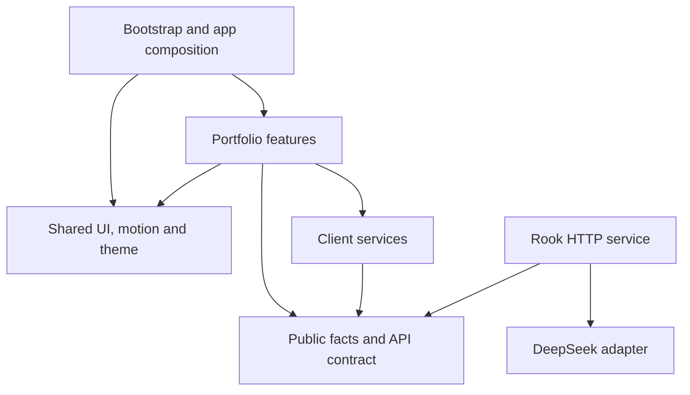

# Portfolio architecture

The client is a feature-based React SPA with layered dependencies. The backend is one small HTTP service for Rook, shared by local development and Firebase Functions. This structure keeps the portfolio straightforward to extend without adding a routing framework, a global business-state store, or service abstractions that the current app does not need.

## Source layout

```text
src/
  main.jsx                  React bootstrap
  app/                      Providers, page composition, navigation, footer, failure UI
    navigation/             Chapter selection, scrolling, focus and navigation view
  features/
    profile/                Original hero, bio and résumé
    experience/             Career view and timeline calculation
    projects/               Desktop grid, mobile carousel, shared details owner
      island/               Optional WebGL lifecycle and procedural world builder
    skills/                 Skill selection and evidence mapping
    achievements/           Professional milestones and certifications
    personal/               Race milestones, interests and finisher celebration
    contact/                Contact view, form hook and pure form model
    rook/                   Launcher, lazy dialog and conversation hook
  shared/
    ui/                     Reusable actions, links, entrances, dialog styling and error boundary
    motion/                 Preference provider, hooks and lazily loaded animation features
    theme/                  Theme provider, tokens/global styling and optional overlay
  services/                 Rook HTTP/fallback, contact delivery and optional analytics
  data/                     Public portfolio facts, chapter definitions and Rook wire limits
  utils/                    Pure public-text formatting
  vendor/                   Existing vendored Three.js engine
server/
  rook.mjs                  Stable HTTP entry point and request orchestration
  rook/context.mjs          Public facts and server-owned system prompt
  rook/validation.mjs       Bounded JSON parsing and message validation
  rook/provider.mjs         DeepSeek request/response translation
functions/index.mjs         Firebase runtime adapter
```

The app eagerly composes all professional/personal sections. Each feature owns its view, local state and styles. Contact and Rook keep substantial stateful behavior in hooks; skills and career timelines use pure model modules. Projects owns one details dialog shared by its grid, carousel and island.

The original hero is retained. Component names now describe responsibilities instead of design-study variants such as `BioB` and `ProjectsG3v2`. Some CSS class names remain from the approved design to preserve its appearance.

## Dependency direction



| Layer          | Allowed local dependencies                         |
| -------------- | -------------------------------------------------- |
| App            | App, features, shared, services, data, utilities   |
| Feature        | Its own feature, shared, services, data, utilities |
| Shared         | Shared and utilities                               |
| Client service | Services, data and utilities                       |
| Data           | Data and utilities                                 |
| Utility        | Utilities                                          |
| Server         | Server, public data and utilities                  |

`config/eslint/architecture.js` checks real import/export/dynamic-import nodes. It rejects unresolved relative imports, missing file extensions, reversed layer dependencies and imports between sibling features. The existing regression suite also checks production module reachability and cycles. These controls are deliberately small and local to this repository.

Public data modules are safe to import in both runtimes. The server prompt and provider credential belong exclusively to the server. No client module imports the server or provider integration.

## State and side effects

- `ThemeProvider` and `MotionProvider` own shared user preferences, including unavailable-storage fallbacks.
- Feature state remains local: project selection, contact drafts and Rook history do not live in a global store.
- `useChapterNavigation` owns scroll/hash/selection subscriptions. `navigateToChapter` is the app-owned navigation command used by links and Rook action callbacks.
- `rookClient` performs HTTP/fallback work and emits actions; it does not scroll or query the DOM.
- `createIsland` owns loading, visibility, resize subscriptions and disposal. `buildIslandWorld` owns the existing procedural geometry, walking and animation behavior.
- The root error boundary provides useful résumé/contact recovery; Rook has a separate boundary so a failed optional chunk does not replace the portfolio.

## Loading policy

| Code                                                        | Loading trigger                                                                       |
| ----------------------------------------------------------- | ------------------------------------------------------------------------------------- |
| Portfolio sections, navigation, preferences                 | Immediate; no boot-animation gate                                                     |
| Motion `domAnimation` features                              | Asynchronous at app startup; included in the UI startup budget                        |
| Rook dialog, Markdown parser, HTTP client and saved answers | First Rook opening; retained after closing to preserve conversation state             |
| Island lifecycle/world                                      | Island selection                                                                      |
| Three.js                                                    | Selected island becomes visible                                                       |
| EmailJS SDK                                                 | Valid, configured contact submission                                                  |
| Firebase Analytics SDK                                      | Configured non-local visit, during idle time; optional failure cannot break rendering |

The build emits a Vite manifest. `npm run audit:bundle` follows the static dependency graph and includes the immediately requested motion features in its UI startup budget: **450 kB minified / 150 kB gzip**. It also asserts that Rook and the island remain dynamic entries. Idle analytics and user-triggered features are outside that critical UI budget; they still have download costs when requested.

The existing Three.js engine remains approximately 664 kB minified / 171 kB gzip and still triggers Vite's unchanged 500 kB per-chunk warning. It is an optional deferred cost. This refactor does not hide the warning by raising the threshold or split one engine into arbitrary files.

## Styling

Shared section/dialog primitives load before feature styles. Feature-specific rules live beside the feature; app layout/navigation and motion settings have their own styles. The existing global styled-components theme is retained. A complete token migration and CSS-class rename are separate work, not claimed as completed here.

## Validation and delivery

`npm run check` runs lint, formatting checks, portfolio regressions, Rook client/server tests, a production build, public-content audit and startup bundle budgets. `npm run build:functions` verifies the Firebase backend package can be generated. CI uses these gates before its existing Firebase delivery step.

Local scratch verification notes and the standalone motion study remain ignored and disconnected from production. The obsolete parallel portfolio components, terminal/sandbox UI, unused integrations, dead boot gate and duplicate package-manager lockfile were removed.

See [API.md](API.md) for request/response details and [CODING_STANDARDS.md](CODING_STANDARDS.md) for enforced principles and explicit remaining gaps. Automated checks do not replace interactive browser verification, real email delivery tests, provider tests or measured Web Vitals.

## Refactor validation snapshot (2026-10-16)

- Node 22.23.3: lint, formatting, **46 tests**, production build, public-content audit, UI startup budgets and Firebase backend packaging passed.
- UI startup JavaScript, including immediately requested motion features: **391.7 kB minified / 128.4 kB gzip**, compared with the previous **629.6 kB / 203.4 kB** entry bundle.
- An in-memory build with placeholder Firebase/EmailJS configuration also passed the budget at approximately **393.0 kB / 128.5 kB gzip**. Firebase modules remained deferred; no provider, analytics or email requests were executed by that build analysis.
- All retained public data exports matched the committed facts, and the original hero JSX matched structurally after ignoring formatting whitespace.
- Old tracked browser screenshots/scripts were untracked while local copies were preserved. The unused phone screenshot and legacy UI/integrations were removed.
- Interactive browser verification was blocked by the browser tool. No claim of visual, swipe, WebGL or focus verification is made for this refactor.

This is a snapshot of the refactor checks; rerun the gates after later changes.
